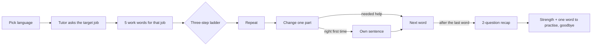

# Job-Ready English: Voice AI Tutor

A voice tutor that teaches entry-level job seekers in India the English words their target job uses, in a 5-minute spoken session. The tutor explains in simple Hindi (or English, if the learner prefers), and the learner practises every sentence aloud in English.

**[Try it: talk to the tutor](https://elevenlabs.io/app/talk-to?agent_id=agent_8601m5x7xma4e4tr0ke8bqm1m5s7)**

Open the link in Chrome on a laptop or phone, allow the microphone, pick **Hindi** or **English** from the language menu, and press **Call AI agent**. If you can't use a microphone, click **Switch to Chat** and type instead. A session lasts about 5 minutes and stops by itself after 7.

---

## The problem

Many entry-level jobs in India, such as telecalling, customer support, retail sales, back office and reception, ask for "basic" or "good" English. A large share of the people applying for them think in Hindi or another Indian language. They often understand simple English, but freeze when they have to make an English sentence on the spot, which is exactly what an interview asks for.

General English apps teach general vocabulary. They don't teach the twelve or so words a telecaller or a receptionist actually uses at work, and they rarely make the learner speak.

## What a session looks like

1. The tutor greets the learner and asks which job they are preparing for.
2. It picks 5 work words for that job, from four role families: telecalling and customer support, sales and retail, back office and data entry, and front office and reception.
3. Each word goes up a **three-step ladder**, and every step ends with the learner saying an English sentence aloud:
   - **Repeat:** the tutor says a work sentence and the learner repeats it.
   - **Change one part:** the learner swaps one part of the sentence ("say *shoes* instead of *shirt*").
   - **Own sentence:** the learner makes their own sentence, with a starter offered. This step only comes when the first two went right without help.
4. The tutor checks the **whole sentence**, not just the word. That includes the small words an interviewer notices, like *a*, *an*, *the*, *is* and plurals. When something is wrong, it gives the corrected sentence and allows one more try per step.
5. A **2-question recap** closes the session. The tutor gives a word's Hindi meaning as a clue and says an English sentence that stops just before the word, and the learner finishes it.
6. The tutor names one thing the learner did well and one word to practise, says goodbye, and ends the call.

The tutor adapts as it goes. A learner who struggles stays on the first two steps. A confident learner skips straight to "change one part" from the third word. A learner who asks it to slow down gets shorter replies and 4 words instead of 5, so the session still reaches the recap within the time limit.

## What's in this repository

| File | What it holds |
|---|---|
| [docs/product-brief.md](docs/product-brief.md) | The problem, the learner, scope, the session design and how success would be measured |
| [docs/decisions.md](docs/decisions.md) | The main product decisions, with the options considered and why each was chosen |
| [docs/testing-and-iterations.md](docs/testing-and-iterations.md) | The 19-test plan and what changed across five versions of the prompt |
| [docs/agent-settings.md](docs/agent-settings.md) | Every platform setting, with the reason for each value |
| [agent/system-prompt.md](agent/system-prompt.md) | The full system prompt the agent runs on, including the four word lists (48 words) |
| [agent/messages.md](agent/messages.md) | The first messages and the time-up messages in Hindi and English |

## How it was built

There is no custom code. The tutor is a configured voice agent:

- **Voice agent platform:** ElevenLabs Agents. It handles speech recognition, the voice and the conversation turns.
- **Language model:** Claude. It runs the lesson, judges each sentence and decides the next step.
- **The product is the prompt:** the system prompt sets the session flow, the ladder, the feedback rules, the guardrails and the word lists. That made fast iteration possible: each version was tested, analysed transcript by transcript, and rewritten.

## Results so far

- The tutor ends the call by itself after its goodbye, and stays in Hindi from greeting to goodbye in Hindi mode.
- It passed all 5 guardrail tests, covering prompt injection, off-topic requests, personal details, claims of being from a company, and job promises.
- The language model took between 0.6 and 1.8 seconds per reply in measured sessions, with the voice starting in about 0.1 seconds after that.
- Five prompt versions, each driven by test findings. The biggest change came from testing: asking a nervous learner to make up a sentence straight away was where sessions stalled. That led to the three-step ladder, which builds up to an own sentence instead of starting with one.

Full details are in [docs/testing-and-iterations.md](docs/testing-and-iterations.md).

## Known limits

- **It can't judge pronunciation.** The language model receives a text transcript of what the learner said, not their voice. The latest prompt asks it to flag a target word that comes out broken in the transcript (a sign the learner stumbled on it), but it can't score accent or clarity.
- **Four role families and 48 words.** Other jobs are mapped to the closest family.
- **Hindi and English only.** Other Indian languages would be the next step.

## Status

A working prototype, built and tested by me as an independent project. It is not affiliated with any company.
